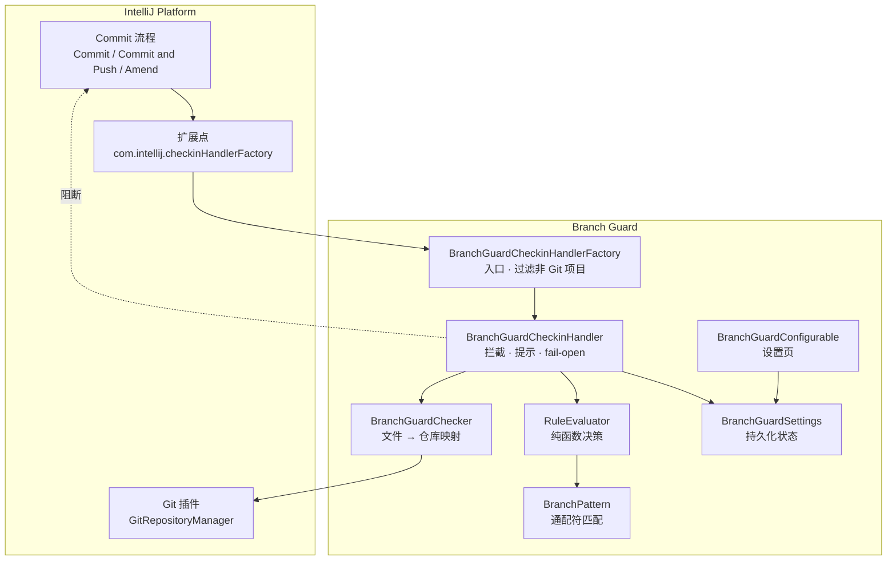
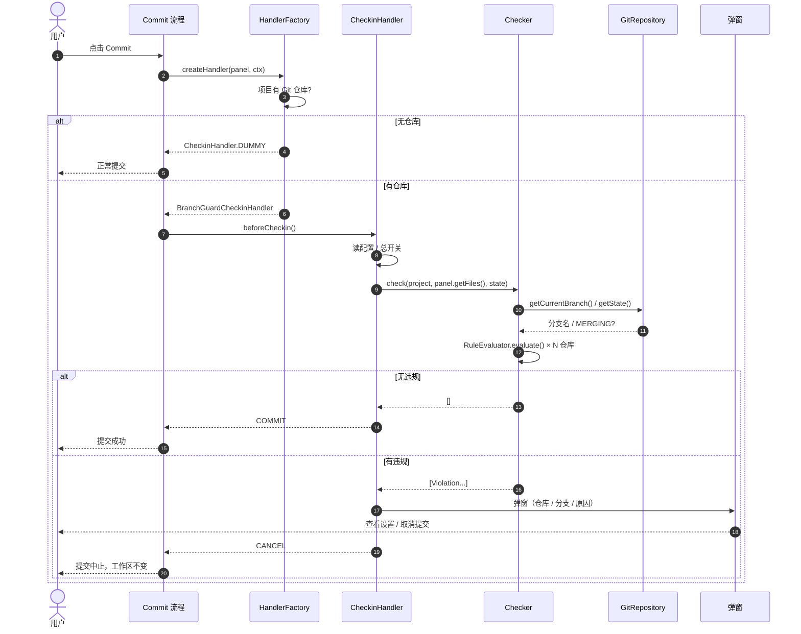

# 02 · 开发设计文档

> 项目：IDEA 插件 **Branch Guard（分支守卫）**
> 文档版本：v1.0 · 2026-10-20
> 对应需求：`01-需求规格说明书.md`
> 目标平台：IntelliJ IDEA **2026.2+**（本机实测 2026.2.1 / build 262.9437.185）
> 语言：Java 25（class 69），构建：Maven 3.9 + IDEA 自带 JBR 25

---

## 1. 设计目标与原则

| 原则 | 落地方式 |
|---|---|
| **拦截必生效** | 使用平台官方 `ReturnResult.CANCEL`，不走 UI 层 hack |
| **绝不添乱** | 全链路 fail-open：任何异常都放行提交，只记 WARN |
| **规则与平台解耦** | 判定逻辑是纯函数（`RuleEvaluator`），不依赖 IDE，可 100% 单测 |
| **单一失效点收敛** | 平台相关代码集中在 `commit` 包（3 个类），未来迁移 `CommitCheck` 只改这一层 |
| **零外部依赖** | 只用平台自带 API + JDK，不引第三方库，包体 < 200 KB |
| **纯读取** | 只读 IDE 内存中的 Git 模型，不起 `git` 子进程、不碰网络、不写文件 |

---

## 2. 技术栈与版本矩阵

| 组件 | 版本 | 说明 |
|---|---|---|
| JDK（编译 + 运行 Maven） | **25**（IDEA 自带 JBR 25.0.3） | 平台类是 class 69，只有 JDK 25 能编译 |
| IntelliJ Platform SDK | **2026.2.1**（Ultimate） | 路径 `D:/Apps/JetBrains/IntelliJ IDEA 2026.2.1` |
| `--release` | **25** | 与 SDK 一致，产物 class 69 |
| `since-build` | **262** | 与 release 25 配套，插件最低跑 2026.2 |
| 构建工具 | **Maven 3.9.x** | 团队指定；JetBrains 官方仅支持 Gradle，需自建（见 §2.1） |
| 编译方式 | Ant `javac` + `fileset` 通配 | classpath 指向 IDE 发行包，不写死 jar 名 |
| 打包方式 | `maven-assembly-plugin` | 产出 `branch-guard/lib/<jar>` 结构的插件 zip |
| 测试 | JUnit 5 + Surefire 3.2.x | 19 个纯逻辑用例，不启动 IDE |

> ⚠️ **兼容性边界**：用 2026.2 SDK 编译的插件只能运行在 2026.2+。若需支持 2023.3–2026.1，必须把 `idea.home` 指向 2023.3.8，并把 `platform.release` 改成 `17`、`since.build` 改成 `233`——三者必须一起改，否则会出现 `class file has wrong version 69.0` 或插件加载被拒。

### 2.1 为什么 Maven 要自建构建链

| 事实 | 证据 | 影响 |
|---|---|---|
| JetBrains 官方只维护 Gradle 链 | 官方支持论坛回复："The official way of developing plugins is using Gradle… We do not have plans for supporting Maven" | 无 `runIde` / `buildPlugin` / `verifyPlugin` / `signPlugin` |
| Maven Central 无官方 Maven 插件 | 检索 `intellij-platform-maven-plugin`、`intellij-maven-plugin` 均 0 条；GitHub 无仓库 | 不能靠一个 `<plugin>` 接入 |
| 平台以整包 zip 发布 | `com.jetbrains.intellij.idea:ideaIC:<ver>:zip`；`git4idea` 为捆绑插件，不单独发布 | 编译 classpath 必须指向本地发行包 |

对应实现：**构建与打包全部收敛在 `pom.xml`**，运行与验证用 IDE 原生能力替代：

```text
mvn compile  →  antrun:javac  ── classpath = ${idea.home}/lib/*.jar
                                          + plugins/vcs-git/lib/*.jar    (2026.x)
                                          + plugins/git4idea/lib/*.jar   (2023.3~2025.x)
mvn package  →  jar + assembly  ── target/branch-guard-1.0.4.zip
本地调试      →  IDEA Plugin Run Configuration（IntelliJ Platform Plugin SDK）
兼容性验证    →  Plugin Verifier CLI（手工执行）
```

**取舍**：多 0.5 人日搭建成本，换取团队统一用 `mvn` 构建、CI 不引入 Gradle。运行调试仍走 IDEA 原生 Plugin SDK，不影响开发体验。

---

## 3. 总体架构



分层职责：

| 层 | 包 | 职责 | 依赖 IDE |
|---|---|---|---|
| 接入层 | `commit` | 扩展点实现、提交面板取数、弹窗 | ✅ |
| 规则层 | `rule` | 决策表、通配符匹配 | ❌ 纯 Java |
| 配置层 | `settings` | 状态持久化、设置 UI | ✅ |

---

## 4. 类设计

| 类 | 职责 | 关键方法 | 依赖 |
|---|---|---|---|
| `BranchGuardCheckinHandlerFactory` | 扩展点入口；非 Git 项目返回 `DUMMY` | `createHandler(panel, ctx)` | `GitRepositoryManager` |
| `BranchGuardCheckinHandler` | 执行校验、组织提示、返回 `CANCEL`；吞异常 | `beforeCheckin()` | Checker / Settings / Messages |
| `BranchGuardChecker` | 把待提交文件映射到 Git 仓库，逐仓库取分支与状态 | `check(project, files, state)` | `ProjectLevelVcsManager`、`GitRepository` |
| `RuleEvaluator` | 决策表实现，纯函数 | `evaluate(state, snapshot)` | 无 |
| `RepoSnapshot` | 单个仓库的判定输入（路径/分支/是否合并中） | record | 无 |
| `BranchPattern` | glob → 正则，`*` `?` 支持 | `matches(branch, pattern)` | 无 |
| `BranchGuardSettings` | `PersistentStateComponent`，写 `.idea/branch-guard.xml` | `getInstance` / `getState` | 平台 |
| `BranchGuardConfigurable` | 设置页，`isModified/apply/reset` | `createComponent()` | Swing / FormBuilder |
| `BranchGuardBundle` | i18n 资源封装 | `message(key, args)` | `DynamicBundle` |

### 4.1 为什么用 `CheckinHandler` 而不是 `CommitCheck`

| 对比项 | `CheckinHandler.beforeCheckin` | `CommitCheck`（2023.1+） |
|---|---|---|
| Java 可用性 | ✅ 普通方法 | ❌ Kotlin `suspend`，Java 需手写 `Continuation` |
| 执行时机 | 提交前，同步 | 提交前，可异步 |
| 阻断能力 | `ReturnResult.CANCEL` | 返回 `CommitProblem` |
| 自定义交互 | 完全自主（可加"跳设置"按钮） | 受平台 `showModalSolution` 约束 |
| 适用场景 | 毫秒级内存校验 | 秒级分析（AI 审核、依赖扫描） |

本插件的校验是纯内存读取（微秒级），没有异步诉求，因此选 `CheckinHandler`。**演进路径**：若未来平台移除 `beforeCheckin`，只需新增一个 Kotlin 类 `BranchGuardCommitCheck` 复用 `BranchGuardChecker`，其余代码零改动。

---

## 5. 关键流程



---

## 6. 关键 API 契约（已核实）

| API | 签名 | 用途 | 备注 |
|---|---|---|---|
| `CheckinHandlerFactory` | `createHandler(CheckinProjectPanel, CommitContext)` | 创建处理器 | EP: `com.intellij.checkinHandlerFactory` |
| `CheckinHandler` | `ReturnResult beforeCheckin()` | 提交前回调 | 返回 `CANCEL` 中止 |
| `CheckinHandler.ReturnResult` | `COMMIT / CANCEL / CLOSE_WINDOW` | 结果码 | `CLOSE_WINDOW` 仅模态对话框有意义 |
| `CheckinProjectPanel` | `Project getProject()` / `Collection<java.io.File> getFiles()` | 取上下文 | ⚠️ `getFiles()` 返回的是 **`java.io.File`**，不是 `VirtualFile` |
| `DynamicBundle` | `new DynamicBundle(Class, String)` | i18n | 2026.2 起 `DynamicBundle(String)` 为 protected |
| `GitRepositoryManager` | `getInstance(Project)` / `getRepositories()` | 仓库列表 | ⚠️ **EDT 禁用** `getRepositoryForRoot(Quick)`：会触发同步仓库更新，平台抛裸 `Throwable`；定位仓库用根路径前缀匹配 |
| `GitRepository` | `getCurrentBranch()` / `getState()` / `getRoot()` | 分支与状态 | 分离 HEAD 时 `getCurrentBranch()` 为 `null` |
| `GitRepository.State` | `MERGING` 等 | 合并判定 | 与状态栏 "Merging…" 同源 |
| `Messages` | `showDialog(Project, String, String, String[], int, Icon)` | 阻断提示 | 首参含 `<html>` 时按 HTML 渲染 |
| `ShowSettingsUtil` | `showSettingsDialog(Project, Class<? extends Configurable>)` | 跳转设置 | 需配置页已注册 |

---

## 7. 配置持久化

`@State(name = "BranchGuardSettings", storages = @Storage("branch-guard.xml"))` + 项目级 service → 文件落在 `<project>/.idea/branch-guard.xml`。

- 该文件**应随仓库提交**，规则改动才能在 MR 中被评审；
- 不存在时使用字段默认值（`State` 的初始值），不报错；
- 序列化依赖 `XmlSerializerUtil`，`enum` 按名字存储，`List<String>` 走 `<list><option value="..."/></list>`。

---

## 8. 详细实现

> 完整源码位于仓库 `src/main/java/com/acme/branchguard/`，本节与代码同步（2026-10-20 实测：`mvn clean package` 通过，19 个单测全绿）。
> 为避免文档与代码双份维护产生漂移，这里保留**工程结构、构建配置、关键实现与踩坑记录**，不再整篇复制源码。

### 8.1 工程结构

```text
idea-branch-guard/
├── pom.xml                                  Maven 构建（编译 / 测试 / 打包）
├── src/assembly/plugin.xml                  assembly 描述符 → branch-guard/lib/<jar>
├── src/main/resources/
│   ├── META-INF/plugin.xml                  插件描述符（版本与 since-build 由 Maven 注入）
│   └── messages/BranchGuardBundle*.properties
├── src/main/java/com/acme/branchguard/
│   ├── BranchGuardBundle.java              i18n 入口
│   ├── rule/                                纯 Java，零 IDE 依赖，可单测
│   │   ├── RuleConfig.java                  规则配置 POJO（含 Mode 枚举）
│   │   ├── BranchPattern.java               glob → 正则
│   │   ├── RepoSnapshot.java                单仓库判定输入（record）
│   │   └── RuleEvaluator.java               决策表
│   ├── settings/                            平台配置层
│   │   ├── BranchGuardSettings.java         PersistentStateComponent
│   │   └── BranchGuardConfigurable.java     设置页
│   └── commit/                              平台接入层
│       ├── BranchGuardCheckinHandlerFactory.java
│       ├── BranchGuardCheckinHandler.java
│       └── BranchGuardChecker.java          文件 → 仓库映射
└── src/test/java/com/acme/branchguard/rule/ 19 个单测（8 + 11）
```

### 8.2 构建配置（`pom.xml`）

四个关键点，其余为标准 Maven 配置：

| 配置 | 值 | 原因 |
|---|---|---|
| `platform.release` | `25` | 2026.2 平台类为 class 版本 69，低版本编译器读不了 |
| `since.build` | `262` | 与 `--release 25` 配套，插件只能跑在 2026.2+ |
| `idea.home` | 本地 IDEA 安装目录 | 平台 jar 不在 Maven 仓库，只能指向发行包 |
| 资源过滤 | `@project.version@` / `@since.build@` | 无 `patchPluginXml`，用过滤注入版本 |

```xml
<!-- 主源码编译：classpath 全部来自发行包，不写死 jar 名 -->
<javac srcdir="${project.basedir}/src/main/java"
       destdir="${project.build.outputDirectory}"
       release="${platform.release}" encoding="UTF-8"
       debug="true" includeantruntime="false">
    <classpath>
        <fileset dir="${idea.home}/lib" includes="*.jar,**/*.jar"/>
        <fileset dir="${idea.home}/plugins"
                 includes="vcs-git/lib/**/*.jar,git4idea/lib/**/*.jar"/>
    </classpath>
</javac>
```

```xml
<!-- plugin.xml 单文件过滤，其余资源原样拷贝 -->
<resources>
    <resource>
        <directory>src/main/resources</directory>
        <filtering>true</filtering>
        <includes><include>META-INF/plugin.xml</include></includes>
    </resource>
    <resource>
        <directory>src/main/resources</directory>
        <filtering>false</filtering>
        <excludes><exclude>META-INF/plugin.xml</exclude></excludes>
    </resource>
</resources>
```

> `maven-compiler-plugin` 设置 `<skipMain>true</skipMain>` 避免与 antrun 重复编译；测试源码仍由它编译（只依赖 `target/classes` 与 JUnit），因此 `rule` 包必须保持零 IDE 依赖。

**打包结构有硬性要求**：插件 zip 解压后必须只有一个顶层目录，描述符按 `<顶层目录>/lib/*.jar!/META-INF/plugin.xml` 被发现：

```text
branch-guard-1.0.4.zip
└── branch-guard/                 ← 顶层目录（缺了它安装必失败）
    └── lib/
        └── branch-guard-1.0.4.jar
```

若 zip 根直接是 `lib/`，IDEA 会把 `lib` 当成插件根目录，转而去找 `lib/lib/*.jar`，安装时报「无法从文件 xxx.zip 加载插件描述符」（已实测踩过，见 §8.9）。

### 8.3 插件描述符（`src/main/resources/META-INF/plugin.xml`）

```xml
<idea-plugin>
    <id>com.acme.branchguard</id>
    <name>Branch Guard</name>
    <version>@project.version@</version>
    <vendor email="jly9948@163.com" url="https://github.com/OscaLibra">JiangLingyun</vendor>
    <idea-version since-build="@since.build@"/>

    <depends>com.intellij.modules.platform</depends>
    <depends>Git4Idea</depends>

    <extensions defaultExtensionNs="com.intellij">
        <checkinHandlerFactory implementation="com.acme.branchguard.commit.BranchGuardCheckinHandlerFactory"/>
        <projectService serviceImplementation="com.acme.branchguard.settings.BranchGuardSettings"/>
        <projectConfigurable id="com.acme.branchguard.settings"
                            displayName="Branch Guard"
                            instance="com.acme.branchguard.settings.BranchGuardConfigurable"/>
        <notificationGroup id="Branch Guard" displayType="BALLOON"/>
    </extensions>
</idea-plugin>
```

构建后实测注入结果：`<version>1.0.4</version>`、`<idea-version since-build="262"/>`。

> `Git4Idea` 是 Git 插件的 **plugin id**（不是目录名）。2026.2 的目录是 `plugins/vcs-git/`，但 jar 内 `META-INF/plugin.xml` 的 `<id>` 仍是 `Git4Idea`，已实测确认。

### 8.4 规则层（零 IDE 依赖）

`RuleConfig` 是纯 POJO，`Mode` 枚举也放在这里；`settings` 层的 `State` 只负责持久化，再通过 `toRuleConfig()` 转成规则层对象：

```java
// settings/BranchGuardSettings.State
public RuleConfig toRuleConfig() {
    RuleConfig config = new RuleConfig();
    config.enabled = enabled;
    config.mode = mode == null ? RuleConfig.Mode.WHITELIST : mode;
    config.patterns = patterns == null ? new ArrayList<>() : new ArrayList<>(patterns);
    config.allowMergeCommits = allowMergeCommits;
    config.blockDetachedHead = blockDetachedHead;
    config.blockMessage = blockMessage == null ? "" : blockMessage;
    return config;
}
```

决策表（`RuleEvaluator#evaluate`），判定顺序不可调换：

```java
public static Result evaluate(RuleConfig config, RepoSnapshot repo) {
    if (!config.enabled) return Result.allow(Reason.DISABLED);
    if (config.allowMergeCommits && repo.merging()) return Result.allow(Reason.MERGE_COMMIT);

    String branch = repo.branchName();
    if (branch == null || branch.isBlank()) {
        return config.blockDetachedHead
                ? Result.block(Reason.DETACHED_HEAD)
                : Result.allow(Reason.OK);
    }
    if (config.patterns == null || config.patterns.isEmpty()) {
        return Result.allow(Reason.NO_BRANCH_RULES);
    }

    boolean matched = false;
    for (String pattern : config.patterns) {
        if (BranchPattern.matches(branch, pattern)) {
            matched = true;
            break;
        }
    }

    if (config.mode == RuleConfig.Mode.WHITELIST) {
        return matched ? Result.allow(Reason.BRANCH_ALLOWED)
                       : Result.block(Reason.BRANCH_NOT_ALLOWED);
    }
    return matched ? Result.block(Reason.PROTECTED_BRANCH) : Result.allow(Reason.OK);
}
```

### 8.5 平台适配层：文件 → 仓库

两个**必须注意**的约束：

1. `CheckinProjectPanel#getFiles()` 返回的是 `Collection<java.io.File>`，**不是** `VirtualFile`；
2. **非模态提交的 `beforeCheckin()` 在 EDT 上执行**，而 `GitRepositoryManager.getRepositoryForRoot(Quick)`
   在 EDT 可能触发同步仓库更新，平台直接抛
   `Throwable: Do not call synchronous repository update in EDT`（v1.0.2 实测踩中，
   症状是"时好时坏"——仓库状态新鲜时不触发，重启后第一次提交必触发）。

因此文件 → 仓库的映射**只用只读调用**：`getRepositories()`（纯内存）+ **逐文件**根路径最长前缀匹配：

```java
List<GitRepository> registered = repoManager.getRepositories();

// 每个文件归属到「根路径最长」的仓库，再对仓库去重
for (File file : files) {
    GitRepository owner = locateOwner(registered, file);
    if (owner != null && !hit.contains(owner)) hit.add(owner);
}

private static GitRepository locateOwner(List<GitRepository> repositories, File file) {
    String path = normalize(file);                   // canonical path，反斜杠→正斜杠
    if (path == null) return null;
    GitRepository best = null;
    int bestLength = -1;
    for (GitRepository repo : repositories) {
        String root = normalize(repo.getRoot().getPath());  // VFS 风格：C:/Users/.../repo
        if (root == null) continue;
        if (under(path, root) && root.length() > bestLength) {
            best = repo;                             // 根路径越长 = 越内层
            bestLength = root.length();
        }
    }
    return best;
}

private static boolean under(String path, String root) {
    return path.equals(root) || path.startsWith(root + "/");
}
```

要点：

- **必须"逐文件取最内层"**，不能反过来"遍历仓库收集命中文件"：嵌套仓库 / submodule 场景下，
  子仓库里的文件同时也位于父仓库目录内，后者会把父仓库也算作命中，
  父仓库的分支状态就会连带把一次合法提交误判为违规（v1.0.3 曾踩此坑，v1.0.4 修正）。
  该语义与 1.0.2 使用的 `ProjectLevelVcsManager#getVcsRootFor(file)` 一致。
- **`root + "/"` 判断**：避免 `/repo-x` 误匹配 `/repo`
- **已删除文件**：`File#getCanonicalPath()` 对不存在的路径也能归一化，无需 `LocalFileSystem` 兜底
- **非 Git 文件**：不落在任何 Git 仓库根下的路径自然不命中，静默跳过
- 整个过程零仓库更新调用，EDT 安全；文件数 × 仓库数有限，代价可忽略

分支与合并状态读取（均为缓存值，不触发更新）：

```java
String branchName = repo.getCurrentBranch() == null ? null : repo.getCurrentBranch().getName();
boolean merging = repo.getState() == GitRepository.State.MERGING;
```

### 8.6 拦截层

```java
@Override
public ReturnResult beforeCheckin() {
    long startNs = System.nanoTime();
    try {
        BranchGuardSettings.State state = BranchGuardSettings.getInstance(myProject).getState();
        if (state == null || !state.enabled) return ReturnResult.COMMIT;

        RuleConfig config = state.toRuleConfig();
        Collection<File> files = myPanel.getFiles();
        List<BranchGuardChecker.Violation> violations =
                BranchGuardChecker.check(myProject, files, config);

        if (violations.isEmpty()) return ReturnResult.COMMIT;

        UIUtil.invokeAndWaitIfNeeded(() -> showBlockedDialog(violations, config));
        return ReturnResult.CANCEL;
    } catch (Exception e) {
        LOG.warn("Branch Guard 执行失败，已放行本次提交", e);   // fail-open
        return ReturnResult.COMMIT;
    } finally {
        LOG.debug("Branch Guard 耗时 " + (System.nanoTime() - startNs) / 1_000_000 + " ms");
    }
}
```

三个要点：

1. **fail-open**：`catch (Throwable)` 而非 `Exception`——平台部分断言抛的是裸 `Throwable`（如 §8.9 第 9 条），接不住就会变成插件报错弹窗；任何情况都返回 `COMMIT`；
2. **UI 切线程**：`UIUtil.invokeAndWaitIfNeeded` 在 EDT 上会内联执行，兜住后台线程调用；
3. **返回 `CANCEL`**：平台据此中止提交（含 Commit and Push 链路）。

**工厂里千万不要做仓库判断**。`createHandler` 可能在项目打开、提交面板恢复时就被调用，此刻 `GitRepositoryManager.getRepositories()` 还是空的；若因此返回 `CheckinHandler.DUMMY`，平台会把「不校验」的处理器缓存给整个面板，表现为**首次正常、重启 IDEA 后永远不拦截**。仓库解析必须放在 `beforeCheckin()` 里，每次提交实时取——这正是 v1.0.1 修的 bug（见 §8.9 第 8 条）。

### 8.7 设置层

`State` 的字段直接对应 `branch-guard.xml`（下划线式扁平结构），`Configurable` 只做 UI 与 `State` 的双向映射：

| 方法 | 职责 |
|---|---|
| `isModified()` | `collectFromUi().equals(state)` |
| `apply()` | 逐字段写回 `State`（`PersistentStateComponent` 自动落盘） |
| `reset()` | `State` → 控件 |
| `collectFromUi()` | 控件 → 临时 `State`；空行与 `#` 注释在此过滤 |

设置页包含「弹窗语言」下拉（`FOLLOW_IDE` / `ZH_CN` / `EN`）。该值只影响阻断弹窗，设置页自身始终跟随 IDE 语言——避免"看不懂设置项却要改语言"的死循环。

### 8.8 资源与国际化

```java
private static final DynamicBundle INSTANCE =
        new DynamicBundle(BranchGuardBundle.class, "messages.BranchGuardBundle");

/** locale 为 null 时跟随 IDE */
public static String messageFor(Locale locale, String key, Object... params) {
    if (locale == null) return message(key, params);
    ResourceBundle bundle = ResourceBundle.getBundle(BUNDLE, locale,
            BranchGuardBundle.class.getClassLoader(),
            ResourceBundle.Control.getNoFallbackControl(ResourceBundle.Control.FORMAT_PROPERTIES));
    String pattern = bundle.getString(key);
    return params.length == 0 ? pattern : MessageFormat.format(pattern, params);
}
```

两个关键点：

1. **必须用 `getNoFallbackControl`**：否则在中文系统上请求 `Locale.ENGLISH` 时，JDK 找不到 `_en.properties` 会先回退到**系统默认 Locale**（zh_CN），拿到的仍是中文——实测踩过，见 §8.9 第 6 条；
2. **方法名用 `messageFor` 而不是重载 `message`**：`message(null, key)` 会同时匹配 `message(String, Object...)` 与 `message(Locale, String, ...)`，产生歧义编译错误。

> 默认路径（`locale == null`）仍走 `DynamicBundle`，跟随 **IDE 界面语言**（装了中文语言包才是中文），而不是操作系统 locale——这是平台 NLS 的既定行为，实测默认英文。

### 8.9 编译期真实踩坑记录

| # | 现象 | 根因 | 处理 |
|---|---|---|---|
| 1 | `Collection<File> cannot be converted to Collection<VirtualFile>` | `getFiles()` 返回 `java.io.File` | 曾用 `LocalFileSystem#findFileByIoFile` 转换（删除文件用父目录兜底）；1.0.4 起因第 9 条改为**纯路径匹配**，不再触碰 `LocalFileSystem` |
| 2 | `DynamicBundle(String)` 不可见 | 2026.2 改为 protected | 改用 `DynamicBundle(Class, String)` |
| 3 | 编译通过但运行必崩（若沿用旧路径） | 2026.2 中 Git 插件目录由 `plugins/git4idea` 改为 `plugins/vcs-git` | classpath 同时包含两种路径，或用 `plugins/**` 通配 |
| 4 | `class file has wrong version 69.0, should be 61.0` | 平台用 Java 25 编译，`--release 17` 读不了 | `--release 25` + `since-build=262` |
| 5 | 安装时报「无法从文件 xxx.zip 加载插件描述符」 | zip 顶层直接是 `lib/`，IDEA 把 `lib` 当插件根目录，去 `lib/lib/*.jar` 找描述符 | assembly 加 `<includeBaseDirectory>true</includeBaseDirectory>` + `<baseDirectory>branch-guard</baseDirectory>` |
| 6 | 指定 `Locale.ENGLISH` 取词却返回中文 | `ResourceBundle.getBundle` 找不到 `_en` 时先回退**系统默认 Locale**，中文机器上就拿到 zh_CN | `ResourceBundle.Control.getNoFallbackControl(FORMAT_PROPERTIES)` |
| 7 | 弹窗被长路径撑出横向滚动条、底部文案被挤掉 | Swing HTML 不拆长单词，`<code>` 等宽字体更宽 | 路径只显示最后一段目录名、分支截断 24、正文宽度 480px、去掉 `<ul>`/`<code>` |
| 8 | **首次提交能拦，重启 IDEA 后不再拦截** | `createHandler` 在项目打开/面板恢复时就执行，此时 Git 仓库列表为空，工厂返回 `DUMMY` 并被面板缓存 | 工厂只做 `project` 空/已释放判断；仓库解析移到 `beforeCheckin`，每次提交实时取 |
| 9 | IDE 内部错误弹窗：`Do not call synchronous repository update in EDT`，调用点 `getRepositoryForRootQuick` | **非模态提交的 `beforeCheckin()` 在 EDT 上执行**（协程 `invokeSuspending`），而该 API 在 EDT 可能触发同步仓库更新；仓库状态新鲜时不触发，重启后首提必触发——典型的"时好时坏" | 仓库定位改用 `getRepositories()`（纯内存）+ 根路径最长前缀匹配，零更新调用 |
| 10 | 上述断言逃出了 `catch (Exception)`，直接弹出"插件错误" | 平台抛的是裸 `java.lang.Throwable` | fail-open 分支改 `catch (Throwable)`，保证任何故障都静默放行并记 WARN |
| 11 | 子仓库（submodule / 嵌套仓库）里提交合法分支却被拦 | 为了绕开第 9 条改成"遍历仓库、谁包含待提交文件就算命中"，父仓库目录同样包含子仓库文件，父仓库分支状态被连带判定 | 反过来做：**逐文件**取"根路径最长"的仓库（最内层），再对仓库去重；语义回到 1.0.2 的 `getVcsRootFor(file)` |

> 这些坑都是"文档写完、真机一跑才发现（或自己改出来的）"的类型，已回写到本节与 §2.1，避免后来人重踩。

---

## 9. 边界处理在代码中的落点

| 场景 | 处理位置 | 代码动作 |
|---|---|---|
| 非 Git 项目 | `Factory.createHandler` | 返回 `CheckinHandler.DUMMY` |
| 混合 VCS（SVN + Git） | `Checker.check` | `getVcsRootFor` / `getRepositoryForRoot` 返回 null 时 `continue` |
| 部分提交 | `Checker.check` | 只遍历 `panel.getFiles()` |
| 多仓库 | `Checker.check` | `LinkedHashSet` 去重后逐个判定，收集**全部**违规 |
| 分离 HEAD | `Checker` + `RuleEvaluator` | `getCurrentBranch()==null` → `RepoSnapshot(branch=null)` |
| 规则为空 | `RuleEvaluator` | 返回 `ALLOW(NO_BRANCH_RULES)` |
| 空提交 | `Checker.check` | `files.isEmpty()` 直接返回空列表 |
| 插件异常 | `Handler.beforeCheckin` | `catch (Exception)` → WARN + `COMMIT` |
| 非 EDT 调用 | `Handler.showBlockedDialog` | `UIUtil.invokeAndWaitIfNeeded` |

---

## 10. 线程模型与性能

| 关注点 | 结论 |
|---|---|
| `beforeCheckin` 执行线程 | 平台通常在 EDT 调用；本插件不假设，UI 一律 `invokeAndWaitIfNeeded` |
| 数据读取 | `GitRepository` 是 IDE 内存模型，读取为 O(1)，**无文件 IO、无子进程** |
| 复杂度 | O(文件数 + 仓库数 × 规则数)，实际 < 1 ms |
| 弹窗代价 | 仅违规时发生（正常路径 0 弹窗），不影响日常提交 |
| 内存 | 无缓存、无监听器，随提交即弃 |

**明确不做的事**：不缓存 `GitRepository` 引用（仓库可能被重载）、不注册 `GitRepositoryChangeListener`（无用）、不做后台预热。

---

## 11. 构建、调试与发布

### 11.1 环境准备（一次性）

```bash
# 直接用 IDEA 自带的 JBR 25（本机没有独立 JDK 17/25）
export JAVA_HOME="D:/Apps/JetBrains/IntelliJ IDEA 2026.2.1/jbr"      # Git Bash
# CMD:  set "JAVA_HOME=D:\Apps\JetBrains\IntelliJ IDEA 2026.2.1\jbr"

mvn -v        # 必须显示 Java version: 25.x
```

> 编译 2026.2 的 SDK 必须 JDK 25；`mvn` 若仍跑在 JDK 8 上，会在 `validate` 阶段被 enforcer 拦下并提示 `JAVA_HOME must point to JDK 17+`（提示语刻意用英文：中文在 Windows GBK 控制台会乱码）。

`pom.xml` 里的 `<idea.home>` 指向本地 IDEA 安装目录（需含 `lib/` 与 `plugins/vcs-git/`）。CI 上用 `-Didea.home=/opt/idea` 覆盖，不必改文件。

### 11.2 常用命令

```bash
# 编译 + 测试 + 打包（产物：target/branch-guard-1.0.4.zip）
mvn clean package

# 只跑单元测试
mvn test

# 跳过测试快速出包
mvn -DskipTests package

# 指定其他平台版本验证（不改 pom）
mvn -Didea.home="/c/Program Files/JetBrains/IntelliJ IDEA 2025.3" clean package
```

### 11.3 本地运行与调试（IDEA Plugin Run Configuration）

Maven 不提供 `runIde`，用 IDEA 原生插件调试能力替代，体验一致：

```text
1. File → Project Structure → SDKs → Add IntelliJ Platform Plugin SDK
   选择 ${idea.home}，JDK 选 17
2. Project Structure → Modules → branch-guard → Dependencies
   添加该 SDK，Scope 设为 Provided
3. Run → Edit Configurations → + → Plugin
   Use classpath of module: branch-guard
4. Debug 启动，自动拉起沙箱 IDE
```

> 第 2 步同时解决了「Maven 无平台依赖、IDEA 里代码标红」的问题：代码补全由 IDE SDK 提供，Maven 只负责编译与打包，两者互不干扰。

**安装包验证**：`mvn package` 后 → `Settings → Plugins → ⚙ → Install Plugin from Disk` → 选 zip → 重启。

### 11.4 兼容性验证（Plugin Verifier CLI）

```bash
# 从 JetBrains 下载最新 verifier-cli 后执行
java -jar verifier-cli-<version>.jar check-plugin \
     target/branch-guard-1.0.4.zip \
     "D:/Apps/JetBrains/IntelliJ IDEA 2026.2.1"
```

`since-build=262` 且未设 `until-build`，建议用 Verifier 额外跑 2026.3 EAP 与下一版本，提前发现不兼容。

### 11.5 CI 流水线

```yaml
# 以 GitHub Actions 为例，其他 CI 同理
- uses: actions/setup-java@v4
  with: { java-version: '17', distribution: 'temurin' }
- run: mvn -B clean package
- uses: actions/upload-artifact@v4
  with: { name: branch-guard, path: target/branch-guard-*.zip }
```

> 流水线里需要先准备 IDE 发行包（缓存到固定路径），然后 `mvn -Didea.home=/opt/idea ...`。

### 11.6 发布与签名

| 场景 | 做法 |
|---|---|
| 内网首版 | 制品库托管 zip，README 写安装步骤（最快） |
| Marketplace | 上传 `target/branch-guard-1.0.4.zip`；平台统一签名 |
| 离线分发且要求签名 | 用 JetBrains `marketplace-zip-signer` CLI 对 zip 签名 |

> Maven 没有官方的 `signPlugin` / `publishPlugin` 等价目标，以上均为手工或脚本步骤，需写进发布检查表。

---

## 12. 测试方案

### 12.1 单元测试（纯 JVM，不需要 IDE）

`BranchPatternTest`

| 用例 | 输入 | 期望 |
|---|---|---|
| 精确匹配 | `main` / `main` | true |
| 精确不匹配 | `main` / `main2` | false |
| 前缀通配 | `feature/login` / `feature/*` | true |
| 通配跨斜杠 | `feature/a/b` / `feature/*` | true |
| 单字符通配 | `dev1` / `dev?` | true |
| 正则元字符 | `release/2.3` / `release/2.3` | true（`.` 不被当通配） |
| 空规则 | `main` / `""` | false |
| 大小写敏感 | `Main` / `main` | false |

`RuleEvaluatorTest`

| 用例 | 配置 | 输入 | 期望 |
|---|---|---|---|
| 总开关关闭 | `enabled=false` | 任意 | ALLOW / DISABLED |
| 白名单命中 | WHITELIST `dev` | `dev` | ALLOW |
| 白名单未命中 | WHITELIST `dev` | `main` | BLOCK / BRANCH_NOT_ALLOWED |
| 黑名单命中 | BLACKLIST `main` | `main` | BLOCK / PROTECTED_BRANCH |
| 黑名单未命中 | BLACKLIST `main` | `dev` | ALLOW |
| 合并豁免 | BLACKLIST `main`, allowMerge | `main`, merging=true | ALLOW / MERGE_COMMIT |
| 关闭合并豁免 | allowMerge=false | `main`, merging=true | BLOCK |
| 分离 HEAD 拦截 | blockDetached=true | branch=null | BLOCK / DETACHED_HEAD |
| 分离 HEAD 放行 | blockDetached=false | branch=null | ALLOW |
| 规则为空 | patterns=[] | `main` | ALLOW / NO_BRANCH_RULES |
| 优先级 | merging=true 且 enabled=false | — | ALLOW / DISABLED |

```java
class RuleEvaluatorTest {

    private static RuleConfig blacklist(String... patterns) {
        RuleConfig config = new RuleConfig();
        config.mode = RuleConfig.Mode.BLACKLIST;
        config.patterns = new ArrayList<>(List.of(patterns));
        return config;
    }

    @Test
    void protectedBranchIsBlocked() {
        RuleEvaluator.Result r = RuleEvaluator.evaluate(
                blacklist("main"), new RepoSnapshot("/repo", "main", false));
        assertEquals(RuleEvaluator.Verdict.BLOCK, r.verdict());
        assertEquals(RuleEvaluator.Reason.PROTECTED_BRANCH, r.reason());
    }

    @Test
    void mergeCommitIsAllowed() {
        RuleEvaluator.Result r = RuleEvaluator.evaluate(
                blacklist("main"), new RepoSnapshot("/repo", "main", true));
        assertEquals(RuleEvaluator.Verdict.ALLOW, r.verdict());
        assertEquals(RuleEvaluator.Reason.MERGE_COMMIT, r.reason());
    }
}
```

> 实测结果：`mvn test` → `BranchPatternTest` 8 个、`RuleEvaluatorTest` 11 个，**全部通过**（Failures 0 / Errors 0）。

### 12.2 手工验收用例（对照需求 AC）

| 用例 | 步骤 | 期望 |
|---|---|---|
| M-01 | 黑名单 `main`，在 `main` 上改文件 → Commit | 弹窗阻断，`git log` 无新提交 |
| M-02 | 同上，点"查看规则设置" | 设置页打开，提交仍未发生 |
| M-03 | 切到 `feature/x` → Commit | 提交成功 |
| M-04 | 合并 `release` 到 `main`，解决冲突后 Commit | 提交成功，无弹窗 |
| M-05 | 两仓库项目，只勾选合规仓库文件 | 提交成功 |
| M-06 | 两仓库项目，两仓库文件都勾选 | 阻断，弹窗列出不合规仓库 |
| M-07 | `git checkout <hash>` 后 Commit | 阻断，提示分离 HEAD |
| M-08 | 关闭总开关 → 在 `main` 上 Commit | 提交成功 |
| M-09 | 修改规则并 Apply → 立即提交 | 新规则生效，无需重启 |
| M-10 | Commit and Push 在 `main` 上 | 阻断，且**不会** push |
| M-11 | 纯 SVN 项目提交 | 无任何提示 |
| M-12 | 中文/英文 IDE 语言切换 | 文案跟随语言 |

### 12.3 POC 验证清单（开发前置，1 人日）

1. 在 2025.3（非模态默认）下，`beforeCheckin` 弹 `Messages.showDialog` 是否正常显示、有焦点、不报 `Thread context was already set`；
2. 返回 `CANCEL` 后，提交面板内容是否保留、Commit 按钮是否可再次点击；
3. "Commit and Push" 被 `CANCEL` 后，是否确实未 push；
4. 多仓库项目 `panel.getFiles()` 是否正确返回跨仓库文件；
5. 合并冲突解决后 `getState()` 是否稳定为 `MERGING`。

> 若第 1 项失败 → 切换降级方案：改为 `Notification` + `CANCEL`（无模态阻塞），或引入 Kotlin `CommitCheck`。

---

## 13. 需求 → 设计 → 测试追溯矩阵

| 需求 | 设计落点 | 测试 |
|---|---|---|
| FR-01 提交前拦截 | `Factory` + `Handler.beforeCheckin` | M-01, M-10 |
| FR-02 规则匹配 | `BranchPattern` + `RuleEvaluator` | 单测 8 + 11 条, M-03 |
| FR-03 合并豁免 | `RuleEvaluator`（`merging` 分支） | 单测, M-04 |
| FR-04 多仓库 | `Checker.check`（`LinkedHashSet`） | M-05, M-06 |
| FR-05 部分提交 | `Checker.check`（仅 `panel.getFiles()`） | M-05 |
| FR-06 分离 HEAD | `Checker` + `RuleEvaluator` | M-07 |
| FR-07 提示与引导 | `Handler.buildMessage` + `Messages.showDialog` | M-01, M-02 |
| FR-08 配置界面 | `BranchGuardConfigurable` | M-09 |
| FR-09 持久化共享 | `@State/@Storage` | M-09 + 手工检查 `.idea/branch-guard.xml` |
| FR-10 全局开关 | `State.enabled` + 警示条 | M-08 |
| FR-11 非 Git 静默 | `Factory` 返回 `DUMMY` | M-11 |
| FR-12 Fail-Open | `try/catch` + WARN | 故障注入（临时抛异常） |
| FR-13 临时放行 | — | v1.0 不实现（见需求 §6 FR-13），v1.1 排期 |
| NFR-01 性能 | 纯内存读取 | 日志耗时字段 |
| NFR-02 兼容性 | `since-build=262`、`--release 25` | Plugin Verifier CLI |
| NFR-04 i18n | `DynamicBundle` + `_zh_CN` | M-12 |

---

## 14. 兼容性与升级策略

| 平台 / 场景 | 影响 | 应对 |
|---|---|---|
| 2026.2 平台 JDK 25 | 必须 `--release 25`，产物 class 69 | 已按此配置，`since-build=262` |
| 需支持 2023.3–2026.1 | 当前产物无法加载（class 69 > 61/65） | 改用 2023.3.8 SDK，并同时改 `platform.release=17`、`since.build=233`、`idea.home` |
| `beforeCheckin` 被标记废弃 | 仍可用 | 观察 Release Notes，准备 `CommitCheck` 适配类 |
| 2026.x Git 插件目录改为 `plugins/vcs-git` | classpath 拿不到 `git4idea.*` | classpath 同时匹配 `vcs-git` 与 `git4idea` 两种路径 |
| 非模态提交成为唯一形态 | 需验证弹窗 | POC + 降级方案 |

**版本号策略**：`主版本.次版本.修订号`；平台不兼容变更 → 升主版本并在 `plugin.xml` 的 `change-notes` 说明。

---

## 15. 交付物清单

| # | 交付物 | 说明 |
|---|---|---|
| 1 | 插件源码工程 | Maven 工程（`pom.xml` + `src/assembly/plugin.xml`），10 个类 + 双语资源 |
| 2 | 单元测试 | `rule` 包覆盖 19 个用例，全部通过 |
| 3 | `branch-guard-1.0.4.zip` | 实测 31 KB，结构 `branch-guard/lib/branch-guard-1.0.4.jar`，可离线安装 |
| 4 | 本文档 + 需求文档 + 可行性分析 | 随仓库归档 |
| 5 | POC 验证报告 | 5 项验证结论与截图 |
| 6 | 接入说明（README） | 安装、配置、规则示例、FAQ |

---

## 16. 已知限制与未验证项

**已知限制**（与需求文档 §12 对应）：

- 合并过程中顺带勾选的文件同样放行；
- `--amend` 已存在的合并提交会被拦截；
- 用户可禁用插件绕过，不构成安全边界。

**已验证（2026-10-20 实测）**：

| 项 | 结果 |
|---|---|
| 编译 | `mvn clean package` → **BUILD SUCCESS**（JDK 25 / JBR 25.0.3） |
| 单测 | 19 个用例，**Failures 0 / Errors 0** |
| 打包 | `target/branch-guard-1.0.4.zip`，31 KB，结构 `branch-guard/lib/branch-guard-1.0.4.jar` |
| 描述符注入 | 产物内 `<version>1.0.4</version>`、`<idea-version since-build="262"/>` |
| 依赖 ID | Git 插件描述符的 `<id>` 实测为 `Git4Idea`（目录名已是 `vcs-git`） |
| 字节码版本 | class major = **69**（Java 25），与 2026.2 平台一致 |

**未验证项（发布前必须闭环）**：

| # | 未验证项 | 验证方式 |
|---|---|---|
| U-01 | ~~代码未在真实 SDK 编译~~ | ✅ 已通过 |
| U-02 | `beforeCheckin` 在非模态提交下的弹窗行为 | 装包后在 Commit 工具窗实测 |
| U-03 | `Messages.showDialog` 的 HTML 渲染与按钮默认态 | 同上 |
| U-04 | `projectConfigurable` 未设 `parentId` 时的落点 | 安装后目视 Settings |
| U-05 | `getState()==MERGING` 在 IDEA 内完成合并时是否恒成立 | 真实合并一次 |
| U-06 | `JBTextArea` 在设置页的滚动与尺寸表现 | 安装后目视 |
| U-07 | 插件能否被 IDE 正常加载（EP / descriptor 校验） | 安装 zip 后查 `idea.log` 是否有 `PluginException` |

---

## 17. 演进路线

| 版本 | 内容 | 前置条件 |
|---|---|---|
| v1.0 | 拦截 + 双模式规则 + 多仓库 + 设置页 | 本文档 |
| v1.1 | ① 精确判定"提交内容是否全部来自合并"；② `--amend` 合并提交识别（`HEAD^2`）；③ 本地临时放行 + 提交信息审计标记 | 用户反馈 |
| v1.2 | 规则支持 per-repo 覆盖（monorepo 场景）；规则文件改为 `.branchguard.yml` 供 hook 复用 | 与 SCM 对齐 |
| v2.0 | 迁移 `CommitCheck`（Kotlin 适配层），支持异步检查（如联动工单系统校验） | 平台 API 稳定 |

---

## 18. 附：关键决策记录

| 决策 | 选择 | 理由 | 撤销条件 |
|---|---|---|---|
| 拦截 API | `CheckinHandler.beforeCheckin` | Java 可直接实现，交互自主 | 平台移除该方法 |
| merge 判定 | `GitRepository.State.MERGING` | 与 IDE 状态栏同源，无额外 IO | 出现稳定漏判案例 |
| 配置位置 | `.idea/branch-guard.xml` | 可随仓库共享、可评审 | 需要跨 IDE（VS Code）共享 |
| 失败策略 | fail-open | 护栏不应制造故障 | 被定位为强制管控 |
| 默认模式 | WHITELIST | 贴合需求字面语义 | 需求方确认为保护主干 |
| 代码组织 | 规则层零 IDE 依赖 | 可单测、可移植到 hook | — |
| 构建工具 | **Maven**（antrun 编译 + assembly 打包） | 团队指定；不引入 Gradle | 官方推出 Maven 插件，或团队改用 Gradle |
| 平台 classpath | 指向本地 `${idea.home}` 通配 | 平台无稳定 Maven 坐标，`git4idea` 不单独发布 | 平台模块坐标在目标版本全部可用 |
| 编译目标 | `--release 25` + `since-build=262` | 本机唯一 SDK 为 2026.2.1，其类为 class 69 | 需要兼容旧版时改用 2023.3.8 SDK |
